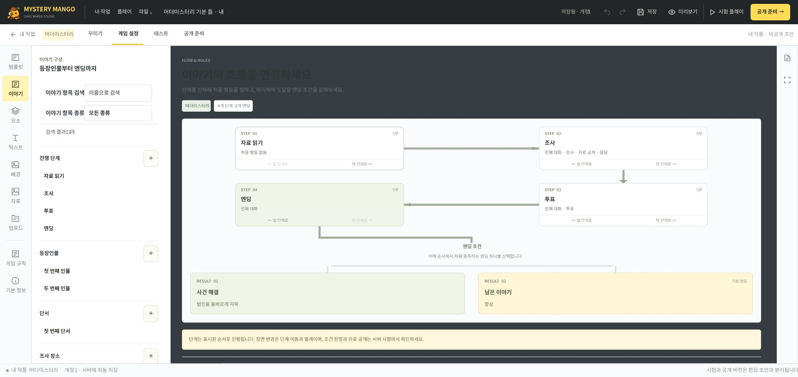
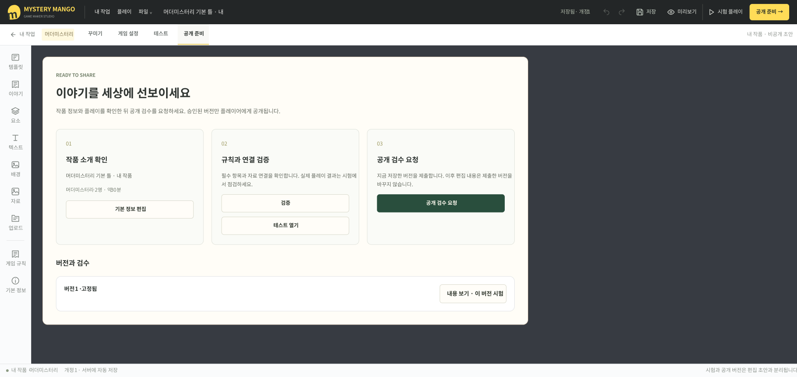

# Mystery Mango · 미스터리 망고

> **나만의 게임을 만들고, 함께 플레이하세요.**

**[🥭 서비스 바로가기](https://mystery.laetipark.me)** · **[🎨 Figma UI 문서](https://www.figma.com/design/Y4orK4LUYK19NXmVlmskdV/mystery-mango)** · **[🖼️ 화면 모아보기](docs/screens.md)** · **[📚 문서 허브](docs/README.md)**

<a id="-프로젝트-소개"></a>

## 🥭 프로그램 소개

머더미스터리와 보드게임을 직접 만들고, 공개된 작품을 골라 혼자 또는 함께 즐기는 한국어 웹 플랫폼입니다. 플레이어는 작품 탐색부터 모집·매칭·게임·기록까지, 창작자는 템플릿 선택부터 편집·시험·검수·공개까지 한 흐름으로 이용합니다.

<details>
<summary>지원 게임과 플레이·제작 흐름</summary>

추리 이야기와 보드게임을 **만드는 공간**과 **함께 즐기는 공간**을 연결합니다. PC에서는 게임판·이야기 흐름·카드 앞뒷면을 편집하고, 모바일에서는 내용 수정과 시험, 실제 플레이를 이어갈 수 있습니다.

| 영역 | 제공하는 경험 |
| --- | --- |
| 작품 탐색 | 게임 종류·인원·장르·난이도·시간으로 공개 작품을 찾고 상세 정보 확인 |
| 모집과 매칭 | 작품에 맞는 방 생성·참가, 친구 초대, 조건에 맞는 자동 매칭 |
| 실제 플레이 | 역할별 자료·조사·대화·투표·엔딩, 카드·말·주사위와 게임별 조작 |
| 제작 스튜디오 | 여섯 유형의 기본·빈 템플릿 12개, 게임판·장면·카드·이야기 편집 |
| 시험과 공개 | 검증 오류 위치 이동, 혼자 또는 초대 시험, 이전 버전 재시험, 검수 후 공개 |
| 내 서재 | 완료·중단한 플레이 기록 확인, Discord 계정 연결 |

### 지원하는 여섯 가지 게임

| 게임 | 인원 | 진행 방식 |
| --- | --- | --- |
| 머더미스터리 | 작품별 1~4명 | 역할·단서·조사·투표·엔딩을 서버가 진행 |
| 자유 테이블 | 작품별 1~4명 | 카드·덱·말·주사위·카운터를 조작하며 참가자가 규칙과 종료를 진행 |
| 요트형 주사위 | 작품별 1~4명 | 주사위 굴림·점수 기록·차례·종료를 서버가 판정 |
| 자유 오목 | 2명 | 착수·차례·승패를 서버가 판정 |
| 리버시 | 2명 | 허용 수·돌 뒤집기·차례·승패를 서버가 판정 |
| 체커 | 2명 | 이동·포획·승급·차례·승패를 서버가 판정 |

실제 방의 인원과 대화 방식은 선택한 작품의 지원 범위를 따릅니다. 머더미스터리 자동 매칭은 4인, 보드게임 자동 매칭은 지원하는 정원 중 2~4인으로 진행합니다. 1인 플레이는 직접 방을 만듭니다.

<a id="-이용-흐름"></a>

### 🧭 이용 흐름

| 플레이어 | 창작자 |
| --- | --- |
| ① 공개 작품 탐색 | ① 기본 또는 빈 템플릿 선택 |
| ② 카카오 로그인 | ② 꾸미기·게임 설정과 저장 |
| ③ 방 생성·참가 또는 자동 매칭 | ③ 구조 검증과 혼자·초대 시험 |
| ④ 정원이 모여 모두 준비한 뒤 시작 | ④ 공개 검수 요청 |
| ⑤ 플레이 후 내 서재에서 기록 확인 | ⑤ 관리자 승인 후 공개 |

운영 회원가입·로그인은 카카오 계정으로 처리합니다. 최초 로그인 시 회원을 생성하며 이메일·비밀번호를 입력하지 않습니다. Discord는 로그인한 사용자가 내 서재에서 별도로 연결하고, 설정이 없으면 텍스트 플레이를 이용합니다. [계정 연결 안내](docs/account-connections.md)를 참고하세요.

</details>

**목차** · [프로젝트 구성](#-프로젝트-구성) · [기술 스택](#-활용-기술-스택) · [환경 설정 및 실행](#-환경-설정-및-실행) · [URL 규칙](#-url-규칙) · [주요 화면](#-주요-화면) · [API 문서](#-api-문서) · [배포 문서](#-배포-문서) · [문서 안내](#-문서-안내)

## 📁 프로젝트 구성

```text
mystery-mango/
├── backend/        Java API·게임 엔진·권한·마이그레이션·테스트
├── frontend/       React 화면·제작 캔버스·브라우저 테스트
├── infra/          정적 프런트 빌드·동일 출처 Nginx 프록시
├── scripts/        운영 배포·백업 스크립트
└── docs/           정책·작품 형식·아키텍처·화면·운영 문서
```

게임 규칙과 열람 권한은 Java 서버가 판정합니다. 웹은 서버가 허용한 개인 자료와 현재 보이는 카드 면을 표시하고, Discord는 음성 대화를 맡습니다. PostgreSQL 트랜잭션·잠금·제약 조건으로 상태와 중복 처리를 관리하며, WebSocket은 변경 알림을 전달하고 REST 조회가 최신 상태의 기준이 됩니다.

초안의 개정 충돌 검사와 불변 공개 버전으로 제작과 실행을 분리합니다. 실제 게임과 작가 시험은 같은 Java 게임 계산·권한별 응답을 공유합니다. 자세한 데이터 모델과 현재 확장 한계는 [아키텍처 문서](docs/architecture.md)에 정리했습니다.

## 🛠️ 활용 기술 스택

<p>
  
  
  
  
  
  
  
  
  
</p>

| 영역 | 기술과 역할 |
| --- | --- |
| 백엔드 | Java 21 · Spring Boot 4.1.1 · JPA/JDBC · JDA 6.7.0 |
| 데이터 | PostgreSQL 17.11 · Flyway 마이그레이션 |
| 프런트엔드 | React 19.2.5 · TypeScript 5.9.3 · Vite 8.0.16 · SCSS Modules |
| 상태·캔버스 | TanStack Query · STOMP · react-konva 19.2.5 / Konva 10.2.0 |
| API 계약 | springdoc 3.1.1 · OpenAPI · 생성 TypeScript 타입 |
| 배포·검증 | Docker Compose · Nginx · Gradle 8.14.4 · Vitest · Playwright |

Spring 계열·Flyway·JUnit·Testcontainers는 Boot BOM을 따릅니다. Docker 기본 이미지 5종은 공식 레지스트리 digest로, Gradle 배포 ZIP은 SHA-256으로 검증하며 npm은 lockfile을 사용합니다.

<a id="-실행"></a>

## ⚙️ 환경 설정 및 실행

### 전체 서비스 실행

Docker Desktop의 Linux 엔진과 Docker Compose가 필요합니다. 전체 실행에는 호스트 JDK나 Node.js가 필요하지 않습니다.

```powershell
Copy-Item .env.example .env
docker compose up --build -d
```

Linux/macOS에서는 첫 줄 대신 `cp .env.example .env`를 사용합니다. [앱 열기](http://localhost:8080), [OpenAPI](http://localhost:8080/api/openapi), [Swagger UI](http://localhost:8080/api/docs).

최초 실행은 공식 이미지와 의존성을 내려받고 Flyway가 빈 DB를 구성합니다. 직접 작성한 머더미스터리 5개(1인용 1개, 2인용 1개, 4인용 3개)와 보드게임 5개(자유 테이블·요트·자유 오목·리버시·체커), 총 10개를 자동 등록합니다. 여섯 게임 유형마다 기본 템플릿과 빈 템플릿을 제공하며, 내 작품을 만들거나 공개 기본 게임을 바로 플레이할 수 있습니다. 기존 서버를 갱신할 때도 아직 없는 작품만 추가하며 기존 작품·게임 기록은 보존합니다. 상태 확인은 `docker compose ps`, 로그는 `docker compose logs backend`를 사용합니다. `docker compose down`은 DB 볼륨을 보존합니다.

기본 `dev` 프로필에서는 다음 개발 계정을 생성합니다. 일반 회원가입도 동작합니다.

| 계정 | 비밀번호 | 권한 |
| --- | --- | --- |
| `player1@example.test` ~ `player8@example.test` | `MangoDev!2026` | 일반 사용자 |
| `admin@example.test` | `MangoDev!2026` | 작품 등록·검증·공개, 신고 조회 |

혼자 확인하려면 작품 탐색에서 1인용을 선택하고 텍스트 방을 만든 뒤 준비 → 시작으로 진행합니다. 2인·4인 플레이는 서로 독립된 브라우저 프로필에서 각각 로그인하고 작품 선택 → 모집방 생성·참가 → 전원 준비 → 방장 시작 순서로 진행합니다. 같은 브라우저 프로필의 일반 탭은 로그인 상태를 공유합니다. 머더미스터리 자동 매칭은 실제 독립 계정 4개가 필요하며 4인용 작품만 선택합니다. 보드게임은 작품의 허용 인원 중 1~4명(고전 게임은 2명)으로 방을 만들고, 2~4명은 버전·인원·모드를 지정해 자동 매칭할 수 있습니다. 제작과 혼자 시험은 [제작 스튜디오 안내](docs/studio.md)를 참고하세요.

개발 계정은 `dev`/`e2e` 프로필에서만 생성합니다. 배포 환경에서는 `SPRING_PROFILES_ACTIVE=prod`, 새로운 DB 비밀번호, HTTPS와 `COOKIE_SECURE=true`, 정확한 `APP_ORIGINS`를 사용합니다. 이미 개발 계정이 생성된 DB를 운영 DB로 재사용하지 않습니다. 최초 운영 관리자는 신뢰된 운영자가 DB의 기존 사용자 `admin` 속성으로 지정합니다.

운영 서버 설치·HTTPS·백업 명령은 [mystery.laetipark.me 배포 안내](docs/deployment.md)를 따릅니다. 운영 실행에는 `scripts/deploy-production.sh`를 사용합니다.

<a id="-화면-개발"></a>

### 프런트엔드 개발

Node.js 22.22.0과 npm을 사용합니다. Windows에서는 실행 정책 충돌을 피하려고 `npm.cmd`를 사용할 수 있습니다.

```powershell
docker compose up --build -d db backend
npm.cmd --prefix frontend ci
npm.cmd run dev:web
```

[개발 화면](http://127.0.0.1:5173)은 `/api`·`/ws`를 백엔드 `http://127.0.0.1:8081`로 전달합니다. `VITE_API_PROXY_TARGET`으로 대상 주소를 바꿀 수 있습니다. Java 코드를 바꾸면 `docker compose up --build -d backend`로 다시 빌드합니다.

JDK 21이 있는 경우 PostgreSQL만 Compose에서 실행하고 `backend` 폴더에서 `./gradlew.bat bootRun` 또는 `./gradlew bootRun`을 사용할 수 있습니다. 로컬 백엔드 기본 포트는 8080이므로 `PORT=8081` 환경 변수를 지정하거나 프런트의 프록시 대상도 맞춥니다. Gradle은 전역 설치 없이 Wrapper를 사용합니다.

<a id="-검증"></a>

### 빌드와 테스트

JDK 21과 Docker가 준비된 환경에서:

```powershell
cd backend
.\gradlew.bat test bootJar
cd ..
npm.cmd --prefix frontend run lint
npm.cmd --prefix frontend run build
npm.cmd --prefix frontend test
```

통합 테스트는 실제 PostgreSQL 17.11을 사용합니다. 기본은 Testcontainers이며 Docker가 없다고 테스트를 건너뛰지 않습니다. 별도의 **폐기 가능한 테스트 DB**가 있으면 `TEST_DATABASE_URL`, `TEST_DATABASE_USER`, `TEST_DATABASE_PASSWORD`를 지정할 수 있습니다. 테스트는 테스트 데이터를 생성·변경하므로 운영 DB를 지정하지 않습니다.

브라우저 테스트에는 실행 중인 서버와 Chromium이 필요합니다. `.env`에서 `SPRING_PROFILES_ACTIVE=e2e`, `GAME_PHASE_SECONDS=12`, `MATCH_VOTE_SECONDS=8`을 설정하고 서버를 다시 시작합니다.

```powershell
npm.cmd --prefix frontend exec -- playwright install chromium
npm.cmd --prefix frontend run test:e2e
```

Playwright가 개발 화면을 실행하고 독립 로그인 컨텍스트로 1인·2인 샘플 진행과 기존 4인 게임·매칭을 검사합니다. 테스트 뒤 일반 플레이에는 `GAME_PHASE_SECONDS=0`, `MATCH_VOTE_SECONDS=60`, `SPRING_PROFILES_ACTIVE=dev`로 복원합니다. [검증 기록과 남은 한계](docs/verification.md)를 확인하세요.

<a id="-계약과-설정"></a>

### 환경 변수

| 설정 | 기본값·역할 |
| --- | --- |
| `DATABASE_URL`, `DATABASE_USER`, `DATABASE_PASSWORD` | JDBC 연결; Compose가 내부 DB 주소를 주입 |
| `SPRING_PROFILES_ACTIVE` | `dev`; 개발 계정 생성은 dev/e2e만 |
| `ASSET_STORAGE_PATH` | 로컬 실행 기본 `.data/assets`; Compose는 `/app/assets` 영속 볼륨 |
| `VOICE_PROVIDER` | `disabled`; 설정 완료 시 `discord` |
| `GAME_PHASE_SECONDS` | `0`: 작품 정의 사용, 양수: 검증용 단계 시간 |
| `MATCH_ACCEPT_SECONDS`, `MATCH_VOTE_SECONDS` | 30초, 60초 |
| `DISCONNECT_GRACE_SECONDS` | 120초 |
| `ABANDON_SECONDS`, `EMPTY_GAME_ABORT_SECONDS` | 300초, 1800초 |
| `APP_ORIGINS`, `COOKIE_SECURE` | 허용 웹 출처·HTTPS 쿠키 정책 |
| `KAKAO_CLIENT_ID`, `KAKAO_CLIENT_SECRET` | 카카오 REST API 키·활성화한 Client Secret. 운영 전환 전 설정 필수 |
| `KAKAO_REDIRECT_URI` | 카카오 앱에 등록한 콜백. 운영: `https://mystery.laetipark.me/api/v1/auth/kakao/callback` |

Discord가 미설정이면 텍스트 플레이가 정상 동작하며 음성 모집은 비활성화됩니다. 봇과 OAuth 설정, 서버 최소 권한, 실제 통화 점검은 [Discord 안내](docs/discord.md)를 따릅니다. API 키·봇 토큰·운영 비밀번호는 커밋하지 않습니다.

## 🔗 URL 규칙

| 주소 | 화면 |
| --- | --- |
| `/` | 서비스 소개와 공개 작품 |
| `/scenarios` · `/scenarios/:id` | 작품 탐색·상세 |
| `/rooms` · `/rooms/:id` | 모집 목록·참가자의 대기실 |
| `/match` · `/games/:id` | 조건별 매칭·참가자의 게임 |
| `/studio` · `/studio/:id` · `/studio/sandboxes/:id` | 제작 목록·소유 작품 편집·권한이 있는 시험 |
| `/account` | 내 플레이 기록·계정 연결 |
| `/login` · `/register` | 서버 설정에 따른 로그인·가입 |
| `/admin` · `/admin/reviews/:id` | 관리자 전용 작품·신고·공개 검수 |

`:id`는 작품·방·게임 등의 식별자입니다. 비공개 화면은 로그인과 서버의 참가·소유·관리자 권한 검사를 거칩니다. 세부 경로와 API 연동 규칙은 [프런트엔드 안내](frontend/README.md#url과-api-규칙)에서 확인할 수 있습니다.

## 🖼️ 주요 화면

아래 이미지는 **2026-10-18에 배포 화면을 확인해 정리한 Figma 문서**에서 가져왔습니다. 저장소의 이후 편집기 보완과 화면 차이는 [이미지 기준과 전체 화면](docs/screens.md)에서 확인할 수 있습니다.

[](docs/screens.md#홈)

| 이야기의 흐름을 연결하는 제작 작업실 | 시험한 버전을 검수하고 공개하기 |
| --- | --- |
| [](docs/screens.md#이야기-편집) | [](docs/screens.md#공개-준비) |
| 역할·단서·진행 단계·엔딩을 한 작업실에서 구성합니다. PC의 정교한 제작과 모바일의 내용 수정·시험을 구분해 지원합니다. | 작품 정보와 규칙 연결을 확인한 뒤 버전을 고정해 시험하고 공개 검수를 요청합니다. 관리자 승인 후 공개하며 이후 초안 수정은 진행 중인 게임을 바꾸지 않습니다. |

[홈 전체 화면 · 템플릿 보관함 · 매칭 · 클릭 프로토타입 보기 →](docs/screens.md)

## 📝 API 문서

OpenAPI는 실행 중인 Java API의 `/api/openapi`에서 제공합니다. 프런트 계약 타입 갱신은 `npm --prefix frontend run generate:api`, 차이 검사는 `npm --prefix frontend run check:api`로 수행합니다. `API_SCHEMA_URL`로 명세 URL을 바꿀 수 있습니다.

| 문서 | 내용 |
| --- | --- |
| [저장된 OpenAPI](docs/openapi.json) | 공개 요청·응답 명세 |
| [프런트엔드 API 계약](frontend/README.md#api-계약과-생성-타입) | 생성 타입과 계약 차이 확인 |
| [작품 형식](docs/scenarios.md) | 게임 정의 JSON·필드·검증 계약 |
| [권한과 상태 전이](docs/policies.md) | 로그인·매칭·개인 자료·게임 복구 규칙 |

## 🚀 배포 문서

- [운영 서버 배포 가이드](docs/deployment.md): mystery.laetipark.me 설치·동일 출처 Nginx·HTTPS·백업·복구
- [계정 연결 설정](docs/account-connections.md): 카카오 앱·Discord 연결과 운영 전환
- [Discord 운영 안내](docs/discord.md): 봇 권한·서버 구성·실제 음성 통화 점검
- [검증 기록](docs/verification.md): 실제 실행 결과와 운영 반영 여부

## 📚 문서 안내

| 문서 | 내용 |
| --- | --- |
| [문서 허브](docs/README.md) | 목적별 시작 안내와 전체 문서 목록 |
| [화면과 Figma 문서](docs/screens.md) | 주요 화면·프로토타입·이미지 출처와 갱신 기준 |
| [프런트엔드](frontend/README.md) | 화면 구성·개발·API 타입·브라우저 검증 |
| [제작 스튜디오](docs/studio.md) | 템플릿·편집·시험·버전·검수·공개 |
| [제작 화면과 반응형](docs/studio-ui.md) | PC·모바일 작업실과 카드 디자인 |
| [아키텍처와 ERD](docs/architecture.md) | 서버·데이터 모델·동시성과 확장 경계 |
| [게임·권한 정책](docs/policies.md) | 매칭·자료 열람·상태 전이·복구 |
| [작품 형식](docs/scenarios.md) | 작품 JSON·필드·검증 계약 |
| [계정 연결](docs/account-connections.md) · [Discord](docs/discord.md) | 카카오·Discord 연결과 실제 통화 점검 |
| [운영 배포](docs/deployment.md) | HTTPS·배포·백업·복구 |
| [검증 기록](docs/verification.md) | 실제 실행 결과와 운영 반영 여부 |
