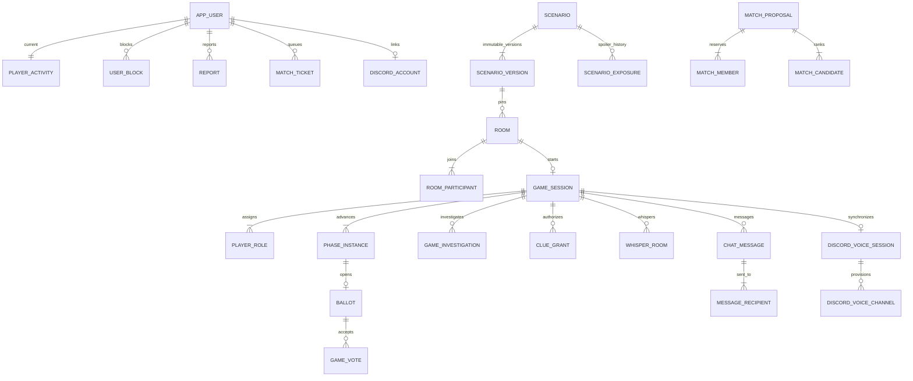

# 아키텍처와 데이터 모델

React → 동일 출처 REST/세션·CSRF → Java 모듈형 모놀리스 → PostgreSQL. WebSocket은 사용자별 상태 변경 알림만 받는다. Discord는 별도 미디어 서비스이며 Java 봇 모듈이 채널 접근을 관리한다. Redis·메시지 브로커·BaaS는 필수 구성에 없다.

인증 사용자는 Spring Data JPA, 복잡한 권한/경합 처리는 같은 DataSource의 JdbcTemplate과 명시적 SQL을 사용한다. Spring 트랜잭션 관리자 아래 JPA/JDBC 변경을 함께 커밋한다. 정적 작품 JSONB와 관계형 게임 상태를 분리한다.

## 무결성

- `player_activity.user_id` PK와 종류/참조 CHECK로 활성 활동 하나를 관리한다. 모든 참가·취소·확정·종료 경로가 같은 트랜잭션에서 갱신한다.
- 사용자별 활성 티켓 partial UNIQUE, 방 참가자 PK, 게임별 역할 UNIQUE, 사용자/조사대상 UNIQUE, 투표 회차/사용자 PK, 단서/사용자 PK, 규칙/원인 PK가 이중 처리를 막는다.
- `command_result(user_id,key)`는 요청 정규화 해시와 결과를 저장한다. 서로 다른 본문에 같은 키를 쓰면 409다. 게임 응답 본문은 저장하지 않고 안전한 결과 식별자를 저장한다.
- 첫 버전은 PostgreSQL transaction advisory lock 하나로 업무 명령·매처·단계 전환을 직렬화한다. 메모리 잠금에 의존하지 않으며 프로세스 재시작 시 DB 트랜잭션이 정리한다. 이는 세부 행 잠금 설계보다 보수적인 구현 선택이며 처리량 한계가 있다. 외부 네트워크 호출은 이 잠금 안에서 하지 않는다.
- outbox는 업무 커밋과 함께 저장한다. 중복 전송은 가능하므로 eventId/stateVersion으로 처리하고 REST snapshot이 최종 기준이다. 비밀 본문은 outbox·공용 이벤트에 넣지 않는다.
- 기록은 종료된 game_session과 player_role의 관계에서 조회한다. 완료·중단을 별도 상태로 보존한다.

## 확장 경계

현재 서버·WebSocket 브로커·봇은 단일 인스턴스다. 매칭은 FIFO 앞쪽 40개 티켓, 최대 10,000개 탐색 단계로 작업량을 제한한다. 대규모 대기열에서는 공정성/처리량을 별도 개선해야 한다. 여러 서버 배포는 공유 이벤트 전달, 스케줄러 소유권, 봇 연결 소유권과 더 세밀한 잠금 검증 후 도입한다.

보존 기간 기반 개인정보·outbox·멱등 기록 정리, 메트릭 대시보드, 운영 백업 자동화는 아직 제공하지 않는다. API liveness/readiness와 추적 ID는 제공한다.

