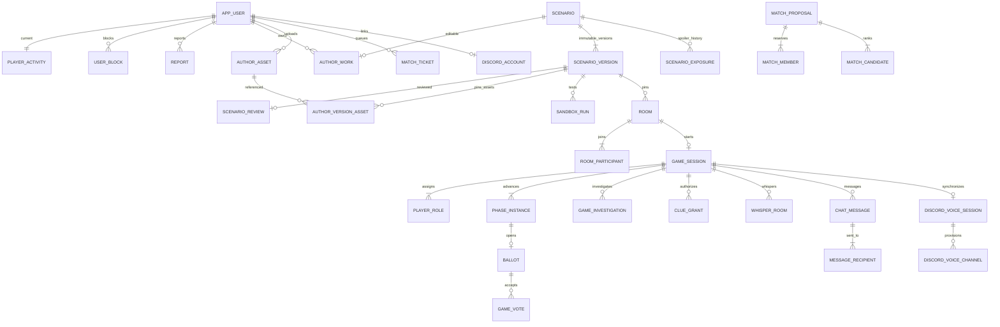

# 아키텍처와 데이터 모델

React → 동일 출처 REST/세션·CSRF → Java 모듈형 모놀리스 → PostgreSQL. WebSocket은 사용자별 상태 변경 알림만 받는다. Discord는 별도 미디어 서비스이며 Java 봇 모듈이 채널 접근을 관리한다. Redis·메시지 브로커·BaaS는 필수 구성에 없다.

인증 사용자는 Spring Data JPA, 복잡한 권한/경합 처리는 같은 DataSource의 JdbcTemplate과 명시적 SQL을 사용한다. Spring 트랜잭션 관리자 아래 JPA/JDBC 변경을 함께 커밋한다. 정적 작품 JSONB와 관계형 게임 상태를 분리한다.

## 무결성

- `player_activity.user_id` PK와 종류/참조 CHECK로 활성 활동 하나를 관리한다. 모든 참가·취소·확정·종료 경로가 같은 트랜잭션에서 갱신한다.
- 사용자별 활성 티켓 partial UNIQUE, 방 참가자 PK, 게임별 역할 UNIQUE, 사용자/조사대상 UNIQUE, 투표 회차/사용자 PK, 단서/사용자 PK, 규칙/원인 PK가 이중 처리를 막는다.
- `command_result(user_id,key)`는 요청 정규화 해시와 결과를 저장한다. 서로 다른 본문에 같은 키를 쓰면 409다. 게임 응답 본문은 저장하지 않고 안전한 결과 식별자를 저장한다.
- 첫 버전은 PostgreSQL transaction advisory lock 하나로 업무 명령·매처·단계 전환을 직렬화한다. 메모리 잠금에 의존하지 않으며 프로세스 재시작 시 DB 트랜잭션이 정리한다. 이는 세부 행 잠금 설계보다 보수적인 구현 선택이며 처리량 한계가 있다. 외부 네트워크 호출은 이 잠금 안에서 하지 않는다.
- outbox는 업무 커밋과 함께 저장한다. 중복 전송은 가능하므로 eventId/stateVersion으로 처리하고 REST snapshot이 최종 기준이다. 비밀 본문은 outbox·공용 이벤트에 넣지 않는다.
- 기록은 종료된 game_session과 player_role의 관계에서 조회한다. 완료·중단을 별도 상태로 보존한다.

## 확장 경계

현재 서버·WebSocket 브로커·봇은 단일 인스턴스다. 머더미스터리 매칭은 FIFO 앞쪽 40개 티켓, 최대 10,000개 탐색 단계로 작업량을 제한한다. 보드게임은 게임·버전·정원·모드·언어별 대기열을 모두 순회하고 각 그룹 앞쪽 80개, 탐색 최대 10,000단계로 제한한다. 대규모 대기열에서는 공정성/처리량을 별도 개선해야 한다. 여러 서버 배포는 공유 이벤트 전달, 스케줄러 소유권, 봇 연결 소유권과 더 세밀한 잠금 검증 후 도입한다.

보존 기간 기반 개인정보·outbox·멱등 기록 정리, 메트릭 대시보드, 운영 백업 자동화는 아직 제공하지 않는다. API liveness/readiness와 추적 ID는 제공한다.

## 제작과 실행의 분리

`author_work.document`는 허용된 필드만 저장하는 편집 초안이다. revision CAS로 다른 탭의 덮어쓰기를 막는다. 동결하면 `scenario_version.definition`과 `presentation` 및 자산 참조를 함께 고정한다. PostgreSQL V6~V8은 기존 작품·정식 게임을 머더미스터리 기본값으로 유지하며 소유자·검수·시험·보드게임 상태·선택 정원을 추가한다. V9는 고전 게임 세 유형과 2인 정원 제약을 확장한다.

`MysteryEngine`은 실제 DB 상태와 `MysterySandboxEngine` 가상 역할 어댑터가 공유하는 행동·조건·효과 계산이다. `BoardEngine`과 고전 게임의 `ClassicEngine`은 실제 게임과 샌드박스가 같은 초기화·명령·권한별 projection을 사용한다. 보드게임 실제 회원도 공통 player_role에 seat-N 좌석으로 기록해 활동·연결·채팅·Discord 복구 정책을 재사용한다. 보드게임에는 머더미스터리 단계·범인 투표 처리를 적용하지 않는다.

자산 파일 디코딩·검사·쓰기와 외부 I/O는 전역 업무 잠금 밖에서 하고 메타데이터 등록·참조·삭제는 Commands 아래 처리한다. 삭제의 물리 파일 정리는 커밋 후 수행한다. 영속 볼륨은 DB와 함께 백업해야 하며 여러 서버 배포 시 공유 저장소와 권한 검증을 유지해야 한다.

## 버전별 시험 관찰 저장

V10의 두 관찰 테이블은 실행 FK로 샌드박스/게임에 연결된다. 샌드박스의 `(sandbox_id, ending_id, observer_kind)` 기본키와 초대 시험의 `game_id` 기본키가 중복을 막는다. 초대 기록의 `is_test=true` 검사와 `(game_id,is_test)` 복합 FK가 정식 게임 연결을 막는다. `EndingObservationService`는 Java 엔딩 확정 후 동일 Commands 트랜잭션에서 기록하며 조회는 부모 실행의 버전 ID로 합산한다. 상태 전이 롤백 시 관찰도 롤백된다. 과거 실행의 엔딩을 소급 기록하지 않는다.
