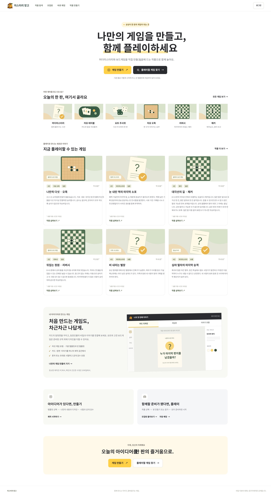
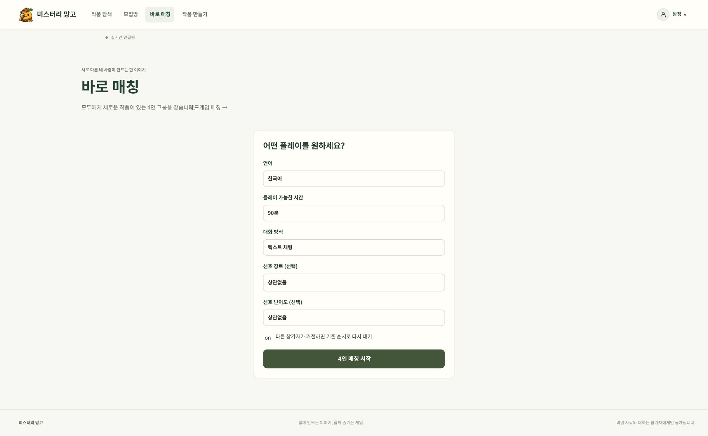
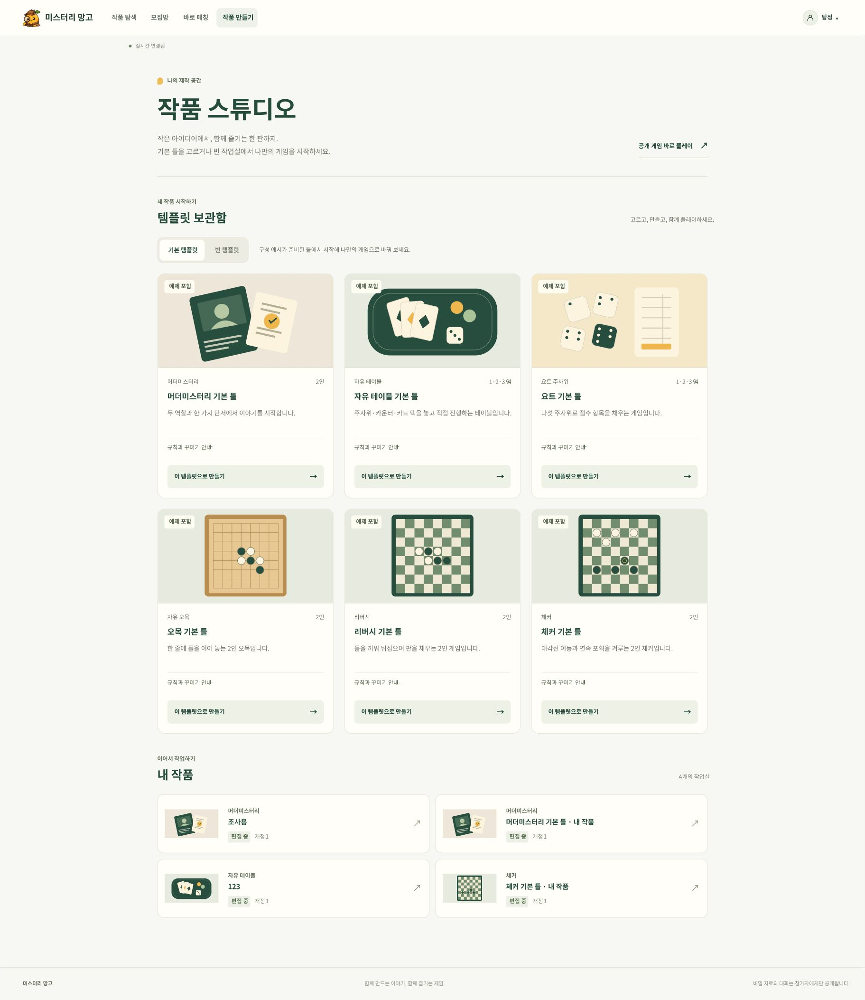

# 🖼️ 미스터리 망고 · 화면과 Figma 문서

공개 작품을 찾는 홈부터 템플릿 선택·이야기 편집·공개 준비까지 주요 화면을 모았습니다. 이미지를 누르면 원본 크기로 확인할 수 있습니다.

[프로젝트 소개](../README.md) · [문서 허브](README.md) · [제작 화면과 반응형](studio-ui.md) · [Figma UI 문서](https://www.figma.com/design/Y4orK4LUYK19NXmVlmskdV/mystery-mango)

## 목차

[홈](#홈) · [바로 매칭](#바로-매칭) · [템플릿과 내 작품](#템플릿과-내-작품) · [이야기 편집](#이야기-편집) · [공개 준비](#공개-준비) · [프로토타입](#프로토타입) · [이미지 기준과 갱신](#이미지-기준과-갱신)

## 홈

게임 만들기와 작품 탐색을 시작하는 화면입니다. 여섯 게임 유형, 실제 공개 작품, 카드 디자인·게임판·이야기 흐름의 제작 예시를 소개합니다.

홈 전체 화면 펼쳐 보기

[Figma 홈 프레임 →](https://www.figma.com/design/Y4orK4LUYK19NXmVlmskdV/mystery-mango?node-id=41-463)

## 바로 매칭

머더미스터리의 4인 매칭 조건을 지정하는 화면입니다. 언어·가능 시간·대화 방식과 선호 조건을 입력합니다. 보드게임은 별도 화면에서 공개 작품과 허용 인원을 선택합니다.

[매칭과 정원 정책](policies.md#모집매칭) · [Figma 매칭 프레임](https://www.figma.com/design/Y4orK4LUYK19NXmVlmskdV/mystery-mango?node-id=68-589)

## 템플릿과 내 작품

여섯 유형의 기본 템플릿과 빈 템플릿을 고르거나, 작업 중인 내 작품을 이어서 편집합니다. 아래 화면은 템플릿과 내 작품, 푸터까지 포함한 전체 높이입니다.

[템플릿과 제작 안내](studio.md) · [Figma 스튜디오 프레임](https://www.figma.com/design/Y4orK4LUYK19NXmVlmskdV/mystery-mango?node-id=68-7743)

## 이야기 편집

예시 머더미스터리의 자료 읽기·조사·투표·엔딩 흐름을 연결도로 확인합니다. 역할·단서·진행 단계의 내용과 조건을 편집하며, 실제 규칙 실행과 자료 열람 판정은 Java 서버가 처리합니다.

[작업실의 화면 구성](studio-ui.md) · [Figma 이야기 편집 프레임](https://www.figma.com/design/Y4orK4LUYK19NXmVlmskdV/mystery-mango?node-id=68-8957)

## 공개 준비

작품 소개·구조 검증·시험·공개 검수 요청과 버전 이력을 확인합니다. 구조 검증 통과, 실제 엔딩 도달, 관리자 승인은 서로 다른 절차입니다. 새 초안을 편집해도 고정한 시험 버전과 진행 중인 게임은 유지됩니다.

[버전·시험·검수 계약](studio.md) · [Figma 공개 준비 프레임](https://www.figma.com/design/Y4orK4LUYK19NXmVlmskdV/mystery-mango?node-id=68-11351)

## 프로토타입

Figma에서 화면을 넘기며 주요 이용 흐름을 확인할 수 있습니다. 아래 링크는 UI 문서의 클릭 연결이며 실제 서비스의 로그인·방 생성·저장·공개 요청을 실행하지 않습니다.

| 흐름 | 연결 |
| --- | --- |
| 홈에서 탐색·모집·로그인, 제작 예시 탭 전환 | [홈 프로토타입](https://www.figma.com/proto/Y4orK4LUYK19NXmVlmskdV/mystery-mango?node-id=41-463&starting-point-node-id=41%3A463&scaling=min-zoom&content-scaling=fixed) |
| 스튜디오 목록 → 편집 → 공개 준비 → 검증 → 시험 → 역할별 자료 비교 | [스튜디오 프로토타입](https://www.figma.com/proto/Y4orK4LUYK19NXmVlmskdV/mystery-mango?node-id=68-7743&starting-point-node-id=68%3A7743&scaling=min-zoom&content-scaling=fixed) |
| 머더미스터리 조건 → 보드게임 작품 선택 | [매칭 프로토타입](https://www.figma.com/proto/Y4orK4LUYK19NXmVlmskdV/mystery-mango?node-id=68-589&starting-point-node-id=68%3A589&scaling=min-zoom&content-scaling=fixed) |

## 이미지 기준과 갱신

- **UI 기준일:** 2026-10-18. 화면 본문과 기능 배치는 당시 배포된 서비스를 브라우저에서 확인해 정리한 Figma UI 문서를 기준으로 합니다.
- **브랜딩 동기화일:** 2026-10-28. 편집 가능한 배너를 추가하고, Figma 화면의 로고 34곳(사이트 헤더 24곳·스튜디오 상단 6곳·제작 예시 4곳)을 망고 탐정 캐릭터로 교체했습니다.
- **출처:** 홈 전체 이미지는 Figma 프레임의 PNG 직접 내보내기입니다. 홈 첫 화면과 매칭·스튜디오 이미지는 Chrome에서 Figma 프로토타입을 100% 배율로 표시한 실제 캡처입니다. 긴 매칭 화면과 스튜디오 목록은 위아래로 스크롤한 캡처를 연결해 전체 높이를 담았습니다. 파일별 획득 방식과 치수는 [이미지 파일 안내](images/README.md#figma-화면-이미지)에 기록합니다.
- **글꼴:** 서비스는 Pretendard를 사용합니다. Figma 문서는 해당 환경의 글꼴 가용성에 따라 Noto Sans KR로 대체되어 있습니다.
- **반영 범위:** 2026-10-28 갱신은 배너와 로고 반영이며, 화면 본문의 기준은 2026-10-18입니다. 저장소의 10월 18일 편집기 좌우 패널·반응형 보완은 당시 운영 서버에 아직 배포되지 않았습니다. 기능별 구현·운영 반영 여부는 [검증 기록](verification.md)을 확인하세요.
- **실행 범위:** 관리자 화면, 다인 매칭 수락·작품 투표, 여섯 게임의 모든 진행 상태를 이 이미지 모음으로 검증한 것은 아닙니다. 일반 플레이에는 작가 시험용 역할 전환·비교 도구가 없습니다.

화면을 갱신할 때는 배포 또는 로컬 화면의 출처, UI 기준일과 브랜딩 갱신일을 구분하고, Figma의 해당 프레임을 수정한 뒤 [이미지 파일 안내](images/README.md)에 따라 같은 경로의 파일을 교체합니다. 직접 내보내기와 브라우저 캡처를 구분해 기록하며, 임시 이미지 주소는 문서에 넣지 않습니다.
